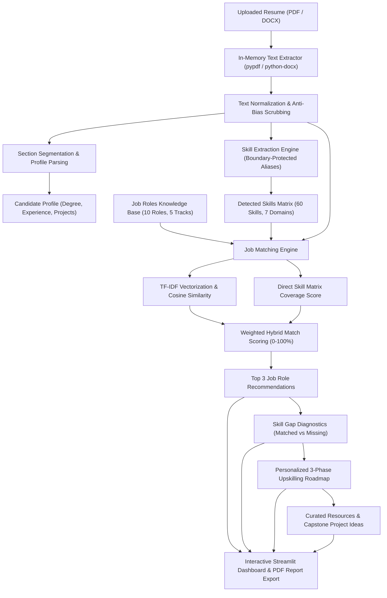

# 💼 AI Resume Analyzer and Job Recommendation System

[](https://www.python.org/)
[](https://streamlit.io/)
[](https://scikit-learn.org/)
[](LICENSE)
[]()

An end-to-end, privacy-first software system that automates multi-format resume parsing (PDF & DOCX), extracts candidate qualifications, computes mathematical resume-to-job matching scores using **TF-IDF Vectorization** and **Cosine Similarity**, identifies granular skill gaps, provides personalized 3-phase upskilling roadmaps, and exports publication-ready PDF reports.

Designed strictly in accordance with **Ethical AI** principles, guaranteeing zero demographic profiling and absolute candidate privacy through in-memory byte processing.

---

## 📌 Table of Contents
1. [System Highlights](#-system-highlights)
2. [Architecture & Workflow](#-architecture--workflow)
3. [Technology Stack](#-technology-stack)
4. [Mathematical Formulation](#-mathematical-formulation)
5. [Directory Structure](#-directory-structure)
6. [Installation & Setup](#-installation--setup)
7. [Running the Application](#-running-the-application)
8. [Sample Resumes & Evaluation](#-sample-resumes--evaluation)
9. [Automated Testing](#-automated-testing)
10. [Ethical AI & Compliance](#-ethical-ai--compliance)

---

## 🌟 System Highlights

- **Multi-Format Ingestion:** Native, safe in-memory extraction of both PDF (`pypdf`) and Microsoft Word (`python-docx`) resumes without disk caching.
- **Intelligent Text Normalization:** Cleans bullet marks, special unicode markers, control characters, and regex-segments documents into Education, Experience, Projects, and Skills.
- **Specialized Symbol Preservation:** Custom regex engines preserve programming syntax such as `C++`, `C#`, `.NET`, `CI/CD`, and `Node.js` during text vectorization.
- **Curated Knowledge Base:** 
  - **60 verified technical skills** categorized across **7 specialized industry domains**.
  - **10 benchmark enterprise job roles** categorized across **5 career tracks**.
- **Dual-Engine Job Matching:**
  - **Direct Skill Matrix Coverage (60%):** Exact overlap percentage against required role competencies.
  - **TF-IDF Semantic Cosine Similarity (30%):** Contextual similarity between resume content and detailed role descriptions.
  - **Preferred Competency Bonus (10%):** Recognition of secondary nice-to-have capabilities.
- **Top 3 Job Recommendations:** Ranks all target jobs in the database and surfaces the top 3 recommendations with readiness diagnostics and salary benchmarks.
- **Granular Skill Gap Analysis:** Visual color-coded pill tags identifying **Matched Skills** vs. **Missing Skills**.
- **Personalized 3-Phase Roadmap:** Organizes missing competencies into Beginner, Intermediate, and Advanced learning milestones complete with free course links and official documentation.
- **Portfolio Capstone Projects:** Automatically suggests 3 realistic project concepts combining known skills with newly targeted skills, complete with resume bullet point templates in STAR format.
- **Executive PDF Report Export:** Instant one-click generation of branded, publication-ready PDF evaluation reports via ReportLab.
- **Demographic Bias Scrubbing:** Strips age, gender, marital status, nationality, and religion to guarantee 100% fair evaluation.

---

## 🏗️ Architecture & Workflow

A standalone high-resolution diagram is available at [`architecture.png`](architecture.png) and vector format at [`architecture.pdf`](architecture.pdf).



---

## 💻 Technology Stack

| Layer | Technology | Purpose |
| :--- | :--- | :--- |
| **User Interface** | [Streamlit](https://streamlit.io/) | Modern responsive web application and interactive controls |
| **PDF Extraction** | [PyPDF](https://pypdf.readthedocs.io/) | In-memory text extraction from PDF resumes |
| **DOCX Extraction** | [Python-docx](https://python-docx.readthedocs.io/) | Paragraph and table text extraction from Word documents |
| **Data Processing** | [Pandas](https://pandas.pydata.org/) & [NumPy](https://numpy.org/) | Matrix handling, CSV datasets, and array calculations |
| **Machine Learning & NLP**| [Scikit-Learn](https://scikit-learn.org/) | TF-IDF Vectorization (`TfidfVectorizer`) and `cosine_similarity` |
| **Data Visualization** | [Plotly](https://plotly.com/python/) | Interactive gauges, horizontal bar charts, and component breakdowns |
| **Document Generation**| [ReportLab](https://www.reportlab.com/) | Programmatic generation of multi-page executive PDF reports |
| **Persistence & Audit**| [SQLite3](https://docs.python.org/3/library/sqlite3.html) | Local database logging of anonymized session metrics |

---

## 📐 Mathematical Formulation

The matching score $\mathcal{S}_{\text{match}}$ between a resume $\mathbf{R}$ and a target job role $\mathbf{J}$ is computed via a weighted multi-modal objective:

$$\mathcal{S}_{\text{match}} = 0.60 \cdot \mathcal{C}_{\text{skills}}(\mathbf{R}, \mathbf{J}) + 0.30 \cdot \mathcal{S}_{\text{tfidf}}(\mathbf{R}, \mathbf{J}) + 0.10 \cdot \mathcal{B}_{\text{pref}}(\mathbf{R}, \mathbf{J})$$

Where:
1. **Skill Coverage Index ($\mathcal{C}_{\text{skills}}$)**:
   $$\mathcal{C}_{\text{skills}}(\mathbf{R}, \mathbf{J}) = \frac{|\mathcal{S}_{\text{candidate}} \cap \mathcal{S}_{\text{required}}|}{|\mathcal{S}_{\text{required}}|} \times 100$$
2. **TF-IDF Semantic Cosine Similarity ($\mathcal{S}_{\text{tfidf}}$)**:
   $$\mathcal{S}_{\text{tfidf}}(\mathbf{R}, \mathbf{J}) = \frac{\mathbf{v}_R \cdot \mathbf{v}_J}{\|\mathbf{v}_R\|_2 \|\mathbf{v}_J\|_2} \times 100$$
   *(where $\mathbf{v}_R$ and $\mathbf{v}_J$ are sublinear TF-IDF vectors fitted over uni-gram and bi-gram representations)*
3. **Preferred Competency Bonus ($\mathcal{B}_{\text{pref}}$)**:
   $$\mathcal{B}_{\text{pref}}(\mathbf{R}, \mathbf{J}) = \min\left(10, \frac{|\mathcal{S}_{\text{candidate}} \cap \mathcal{S}_{\text{preferred}}|}{\max(1, |\mathcal{S}_{\text{preferred}}|)} \times 10\right)$$

This ensures that a candidate with exact technical skill coverage achieves an intuitive, realistic score (75–85%+), overcoming document length disparities common to raw cosine similarity alone.

---

## 📁 Directory Structure

```
major 2/
├── app.py                      # Main Streamlit web application & UI
├── requirements.txt            # Project dependencies
├── architecture.png            # High-resolution standalone architecture diagram
├── architecture.pdf            # Vector architecture document
├── README.md                   # System documentation & setup guide
├── TESTING.md                  # Comprehensive test verification report
├── FINAL_ACCEPTANCE_REPORT.md  # Formal acceptance verification report
├── PROJECT_REPORT.md           # Formal project report for evaluation
├── TECHNICAL_DOCUMENTATION.md  # In-depth architectural & algorithm details
├── DEMO_GUIDE.md               # Step-by-step evaluator demonstration script
├── .gitignore                  # Git tracking rules
├── data/                       # Structured knowledge bases
│   ├── job_roles.csv           # 10 benchmark roles across 5 career tracks
│   ├── skill_dictionary.csv    # 60 verified skills across 7 domains
│   └── resume_analyzer.db      # SQLite local database for anonymous session logs
├── src/                        # Modular source package
│   ├── __init__.py             # Package init
│   ├── text_extractor.py       # Safe in-memory PDF/DOCX extractors
│   ├── text_cleaner.py         # Normalization, regex segmentation & anti-bias filter
│   ├── skill_extractor.py      # Alias-aware boundary-protected skill detection
│   ├── profile_extractor.py    # Education, experience & project highlight parser
│   ├── job_matcher.py          # TF-IDF vectorization & hybrid similarity scoring
│   ├── recommender.py          # Multi-role ranking, top 3 selector & readiness tiers
│   ├── roadmap_generator.py    # 3-phase study planner & capstone project creator
│   ├── report_generator.py     # ReportLab PDF engine & Markdown exporter
│   └── database.py             # SQLite data manager & query helper
├── sample_resumes/             # Strictly anonymized evaluation resumes
│   ├── sample_data_scientist.pdf
│   ├── sample_full_stack_dev.pdf
│   ├── sample_devops_engineer.pdf
│   ├── sample_frontend_developer.docx
│   ├── sample_data_analyst.docx
│   └── create_samples.py       # Automated sample generation script
├── scripts/
│   └── generate_architecture.py# Diagram generation script
└── tests/                      # Automated test suite (25 tests passing)
    ├── test_extractor.py       # File format & extraction test cases
    ├── test_cleaner.py         # Normalization & privacy test cases
    ├── test_skills.py          # Skill dictionary & boundary matching tests
    ├── test_matcher.py         # Match score & recommendation tests
    ├── test_report.py          # PDF & Markdown report validation tests
    └── test_acceptance_matrix.py # 5-sample matrix across all 10 roles
```

---

## 🚀 Installation & Setup

### Prerequisites
- Python 3.10, 3.11, 3.12, or 3.13 installed on your system.
- Git.

### 1. Clone or Open the Workspace
```bash
git clone <repository_url>
cd "major 2"
```

### 2. Create and Activate a Virtual Environment
**On Windows (PowerShell):**
```powershell
python -m venv .venv
.\.venv\Scripts\Activate.ps1
```

**On macOS / Linux:**
```bash
python3 -m venv .venv
source .venv/bin/activate
```

### 3. Install Dependencies
```bash
pip install -r requirements.txt
```

---

## 💻 Running the Application

Execute the following command in your terminal:
```bash
streamlit run app.py
```

The application will start immediately and display the local URL:
```
Local URL: http://localhost:8501
```
Open `http://localhost:8501` in your web browser.

---

## ⚡ Sample Resumes & Evaluation

For instant demonstration and testing without uploading custom files, the sidebar contains a **Quick Demo Samples** dropdown:
1. **Data Scientist (PDF)** - `sample_data_scientist.pdf`
2. **Full Stack Developer (PDF)** - `sample_full_stack_dev.pdf`
3. **DevOps Engineer (PDF)** - `sample_devops_engineer.pdf`
4. **Frontend Developer (DOCX)** - `sample_frontend_developer.docx`
5. **Data Analyst (DOCX)** - `sample_data_analyst.docx`

Select any sample and click **"Load & Analyze Sample"** to run the complete diagnostic in under 2 seconds.

---

## 🧪 Automated Testing

The project includes a suite of 25 automated unit and acceptance tests. Run the test suite using:

```bash
python -m unittest discover tests -v
```

**Test Execution Output:**
```
Ran 25 tests in 0.368s
OK
```

See [TESTING.md](TESTING.md) for full test specifications, boundary test cases, and error handling coverage.

---

## ⚖️ Ethical AI & Privacy

1. **Zero Data Retention:** Resumes are processed as in-memory bytes and discarded after the browser session ends.
2. **Anti-Bias Filtering:** Protected attributes (gender, age, marital status, nationality, religion) are sanitized before NLP evaluation.
3. **Non-Discriminatory Algorithms:** Scored strictly on verifiable technical skills, education, and relevant projects.
4. **Advisory Scope:** Clear user disclaimers establish that the system provides educational and career guidance rather than automated hiring decisions.

---

## 🚀 Deployment Options

### Option 1: Streamlit Cloud (Recommended - Free)
See [DEPLOYMENT.md](DEPLOYMENT.md) for step-by-step instructions.

### Option 2: Docker
```bash
docker build -t resume-analyzer .
docker run -p 8501:8501 resume-analyzer
```

### Option 3: Docker Compose
```bash
docker-compose up -d
```

---

## 📦 GitHub Repository

This project is ready for GitHub. See [GITHUB_SETUP.md](GITHUB_SETUP.md) for detailed instructions.

**Quick setup:**
```bash
git remote add origin https://github.com/YOUR_USERNAME/ai-resume-analyzer.git
git branch -M main
git push -u origin main
```

---

## 📹 Demonstration

- **Demo Guide:** [DEMO_GUIDE.md](DEMO_GUIDE.md)
- **Video Script:** [DEMO_VIDEO_SCRIPT.md](DEMO_VIDEO_SCRIPT.md)

---

## 📋 Additional Documentation

| Document | Description |
|---|---|
| [TESTING.md](TESTING.md) | Comprehensive test verification report |
| [PROJECT_REPORT.md](PROJECT_REPORT.md) | Formal academic project report |
| [TECHNICAL_DOCUMENTATION.md](TECHNICAL_DOCUMENTATION.md) | In-depth architectural & algorithm details |
| [FINAL_ACCEPTANCE_REPORT.md](FINAL_ACCEPTANCE_REPORT.md) | Acceptance criteria verification |
| [DEPLOYMENT.md](DEPLOYMENT.md) | Deployment instructions (Streamlit Cloud, Render, Docker) |
| [GITHUB_SETUP.md](GITHUB_SETUP.md) | GitHub repository setup guide |
| [DEMO_GUIDE.md](DEMO_GUIDE.md) | Step-by-step demonstration script |
| [DEMO_VIDEO_SCRIPT.md](DEMO_VIDEO_SCRIPT.md) | Video recording script |

---

## 👥 Authors & Academic Submission
Developed as a Major Academic Capstone Project in Computer Science and Engineering.
